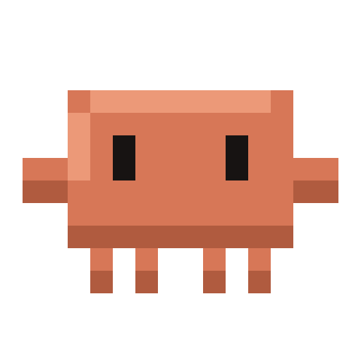
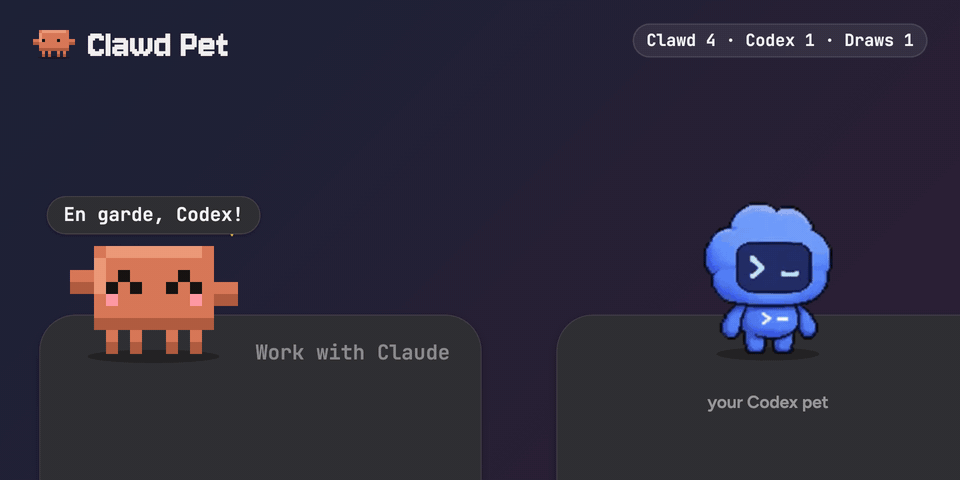
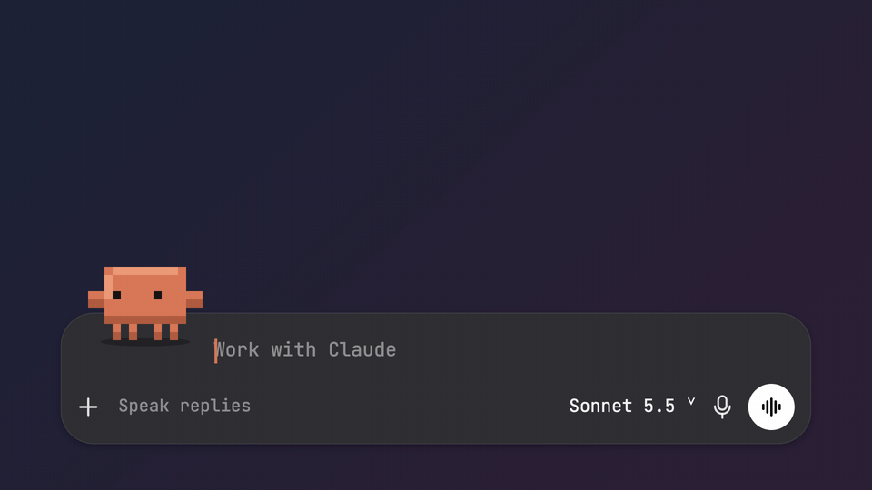
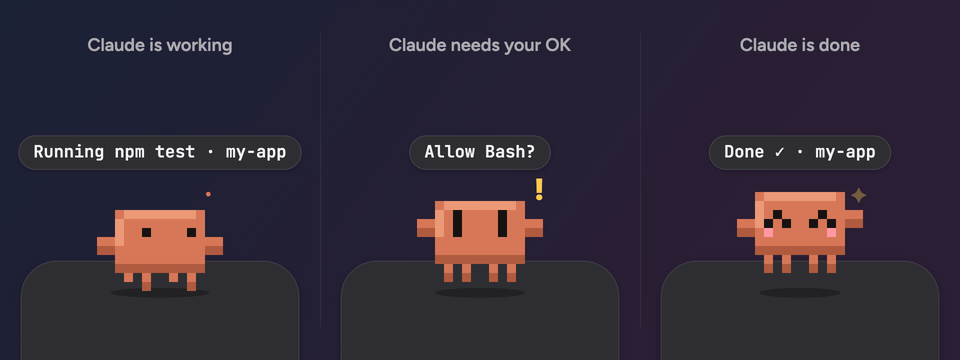
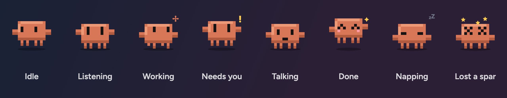

<div align="center">



# Clawd Pet

**Codex got a pet. Claude Code deserved one too.**

A little pixel Clawd who lives in the corner of your screen, right next to the Codex pet.<br>
Talk to him, watch him react while Claude Code works, and let him pick a friendly fight with his neighbor.

[](#install)
[](#install)
[](#windows)
[](LICENSE)
[](https://github.com/muppio/clawd-pet/stargazers)

[**Website**](https://muppio.github.io/clawd-pet/) · [**Install**](#install) · [**What he does**](#what-he-does) · [**FAQ**](#faq)



</div>

## Install

Clawd Pet runs on macOS 14 or later (Apple silicon or Intel) and on Windows 10 and 11. All you need is Claude Code, installed and logged in.

In Claude Code, run:

```text
/plugin install clawd-pet --marketplace muppio/clawd-pet
```

Answer `y` to add the marketplace, then press Enter to install it for your user.

<details>
<summary>From a shell, or in the Claude desktop app</summary>

From a shell:

```bash
claude plugin install clawd-pet --marketplace muppio/clawd-pet
```

In the Claude desktop app, where `/plugin` doesn't run: click **+** next to the prompt box, then **Plugins** › **Add marketplace** with `muppio/clawd-pet`, then **Add plugin**.

</details>

Then type **`/pet`**. The first time, it installs the app that ships with the plugin, which takes a few seconds. After that, `/pet` summons or dismisses Clawd, and new versions install themselves when the plugin updates.

On Windows, a few things work a little differently. See [Windows](#windows).

## What he does

### Talk to him



- **Type** in "Work with Claude" and press Return. The reply streams into his speech bubble, with formatting.
- **Dictate** with the 🎤 button.
- **Talk voice-to-voice.** Tap the white orb and just talk. Claude answers out loud, sentence by sentence, and Clawd listens again until you tap the orb to stop.
- Replies come from **your own `claude` command**. There's no API key, and replies count toward your Claude plan.
- Press **⌃⌥C** from anywhere to start typing to him.

### He watches Claude Code for you



The plugin tells Clawd what each Claude Code turn is doing, so you can look away:

- While Claude works, he walks in place under a spinner and shows what's happening ("Running npm test · my-app").
- He raises a **"!"** when Claude needs your OK.
- He does a happy hop when Claude is done.

Click him to jump straight to the Claude app.

### He spars with your Codex pet

Right-click Clawd and choose **Spar with Codex**, or type `/pet fight`. He picks a fight, runs over, and they vanish into a cartoon dust cloud. Then he walks home with the result. He wins about 45% of rounds, Codex about 40%, and the rest are draws. The score is kept. Turn on **Spar now and then** for a rematch every 20 to 40 quiet minutes.

**Sparring needs the Codex pet on screen.** Open the Codex app and type `/pet` there to bring it out. If it isn't out, Clawd tells you, and **Spar with Codex** stays greyed out. Clawd runs to the spot Codex saved for its pet. He never records your screen, and he never changes the Codex pet.

### He has moods



He blinks and looks around, talks while replies stream in, and naps when things are quiet. Reduce Motion is respected.

### He stays out of the way

- Click him to open the Claude app. Drag him anywhere.
- Right-click for mini mode, the model, voice, sparring and **Open at login**.
- He uses about 1% of one CPU core when idle.

## Commands

| Command | What it does |
| --- | --- |
| `/pet` | Summon or dismiss Clawd. |
| `/pet fight` | Send Clawd to spar with the Codex pet, which has to be on screen. |
| `/pet rebuild` | Build the app yourself from the source in `app/`. This one needs Xcode's command line tools (`xcode-select --install`). |

Links work too: `clawdpet://ask?q=…`, `clawdpet://voice`, `clawdpet://new` and `clawdpet://fight`. They're handy for Shortcuts or Raycast.

## FAQ

**Is it free?**
Yes. Clawd Pet is free and open source (MIT). Chatting with him runs your own `claude` command, so replies count toward your Claude plan, like any other Claude Code use.

**Do I need Codex?**
No. Clawd works on his own. Only sparring needs the Codex pet on screen.

**His voice sounds robotic. Can it sound better?**
Yes. Clawd uses the best US English voice installed on your Mac. Download a **Premium** or **Enhanced** one (Zoe and Ava are lovely) in System Settings › Accessibility › Spoken Content › System Voice › Manage Voices. Then type `/pet` twice to restart him, and he'll use it.

**Does he record my screen or my microphone?**
No screen recording. The microphone is on only after you tap 🎤 or the orb. See [Privacy](#privacy).

**Is this made by Anthropic or OpenAI?**
No. It's an unofficial fan project. See [Not affiliated](#not-affiliated).

## Windows

Clawd runs on Windows 10 and 11 (x64) too. It's a native Windows app with the same features as the Mac one.

You need Claude Code installed and logged in. `/pet` works as on the Mac. The first time, it downloads the Windows app (about 60 MB) from this project's GitHub release, checks it against the checksum pinned in the plugin, and unpacks it into `%LOCALAPPDATA%\ClawdPet`. Nothing else is needed, not even .NET.

What's different from the Mac:

- **Ctrl+Alt+C** opens the composer. On keyboard layouts where that's also AltGr+C (ć on a Polish keyboard, for example), Clawd takes over the key while he's running.
- **Speech** uses Windows' built-in offline speech engine. Dictation and voice need:
  - an English speech recognizer (Settings › Time & language › Speech)
  - microphone access for desktop apps (Settings › Privacy & security › Microphone)

  Spoken replies use the best English voice installed.
- **Sparring** works as on the Mac. If Clawd ever can't find the Codex pet, bring it out, run this in PowerShell and share what it prints in an issue:

  ```powershell
  & "$env:LOCALAPPDATA\ClawdPet\ClawdPet.exe" --codex-windows | Out-String
  ```

- **Settings** live in `%USERPROFILE%\.clawd-pet`. **Open at login** and `clawdpet://` links are per-user registry entries, so no admin rights are needed.

To uninstall on Windows, quit Clawd (right-click him, then **Hide Clawd**) and remove the plugin with `/plugin uninstall clawd-pet`. Then run this in PowerShell:

```powershell
& "$env:LOCALAPPDATA\ClawdPet\ClawdPet.exe" --uninstall
Remove-Item -Recurse -Force "$env:LOCALAPPDATA\ClawdPet", "$env:USERPROFILE\.clawd-pet"
```

## Privacy

- **The microphone** is on only after you tap 🎤 or the voice orb. It stops when you stop talking, or when you tap again. Your Mac turns speech into text on the device whenever macOS supports that for your language. When it doesn't, macOS uses Apple's speech service.
- **What goes to Claude** is only what you type or say. It runs through your own `claude` command with web search and web fetch as its only tools.
- **Finding the Codex pet** uses where Codex's windows sit on screen, and the pet position and size that Codex saves in its own settings file (`~/.codex/.codex-global-state.json`). Clawd only reads those two values from it, and changes nothing. Clawd Pet doesn't record or capture your screen.
- **Local files** on a Mac:
  - the app, in `~/Applications/Clawd Pet.app`
  - Claude Code's status for Clawd, in `~/.clawd-pet/status.json`
  - your settings and sparring score, in `~/Library/Preferences/local.clawdpet.ClawdPet.plist`

  Chats with Clawd run from `~/.clawd-pet/chat`, so Claude Code keeps their transcripts the way it keeps any session's.

## Troubleshooting

- **Clawd doesn't appear.** Run `/pet` again. If he's on another display, right-click him and choose **Snap back next to Codex**.
- **"Clawd Pet can't be opened" from macOS.** This only happens if you downloaded the app yourself instead of installing the plugin. Run `xattr -dr com.apple.quarantine ~/Applications/Clawd\ Pet.app`, then `/pet`.
- **The mic or voice orb does nothing.** Turn on Clawd Pet under System Settings › Privacy & Security › Microphone, and again under Speech Recognition.
- **Replies say Claude isn't found.** Install Claude Code and run `claude` once to log in.

## Uninstall

1. If you turned on **Open at login**, right-click Clawd and turn it off.
2. Right-click Clawd and choose **Hide Clawd**.
3. Remove the plugin with `/plugin uninstall clawd-pet`.
4. Delete the app, its settings and its chat transcripts:

```bash
rm -rf ~/Applications/Clawd\ Pet.app ~/.clawd-pet
rm -rf ~/.claude/projects/*-clawd-pet-chat
defaults delete local.clawdpet.ClawdPet
```

## Contributing

Ideas, bug reports and pull requests are welcome. [CONTRIBUTING.md](CONTRIBUTING.md) explains how the project is laid out and how to build it. The [changelog](CHANGELOG.md) lists what's new.

If Clawd made you smile, a ⭐ helps other Claude Code users find him.

<a href="https://star-history.com/#muppio/clawd-pet&Date">
  
</a>

## Not affiliated

Clawd Pet is an unofficial fan project. It isn't affiliated with, endorsed by or sponsored by Anthropic or OpenAI. Claude, Claude Code and Clawd belong to Anthropic. Codex and the Codex pet belong to OpenAI. The Codex pet artwork in this README and on the website is OpenAI's, from the Codex app. The Codex pet itself is never modified; Clawd only draws next to it.

## License

MIT. See [LICENSE](LICENSE).
